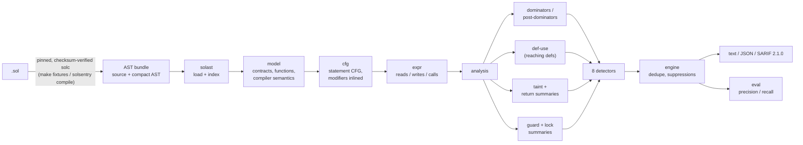

# solsentry

A static security analyzer for Solidity that works on the solc **compact JSON AST**. It builds a
statement-level control-flow graph per function (with modifiers inlined), runs dominator,
def-use and taint analyses over it, and reports eight classic smart-contract bug classes as
text, JSON or **SARIF 2.1.0** for code-scanning UIs.

Pure Python 3.12, no runtime dependencies, no compiler needed at analysis time.

| Detector | SWC | Severity | What it reports |
|---|---|---|---|
| `reentrancy` | 107 | high | storage written on a path after a control-transferring external call |
| `tx-origin` | 115 | medium | a gating condition whose taint includes `tx.origin` |
| `unchecked-call` | 104 | medium | `call`/`delegatecall`/`staticcall`/`send` result never reaching a check |
| `unprotected-selfdestruct` | 106 | high | `selfdestruct` not dominated by a caller-identity check |
| `unprotected-delegatecall` | 112 | high | `delegatecall` to a caller-controlled target without an identity check |
| `missing-access-control` | 105 | high | unguarded writes to authorization state, or whole-balance withdrawals |
| `integer-overflow` | 101 | high | wrapping arithmetic (solc < 0.8 or `unchecked {}`) on attacker-influenced values without a pre/post check |
| `timestamp-dependence` | 116 | medium / low | `block.timestamp` used as randomness (`%`) or compared for strict equality |

Every detector's exact rule, anchor line and known false-positive / false-negative classes are
in [`docs/DETECTORS.md`](docs/DETECTORS.md). The same limits are embedded in each SARIF rule's
`help` text.

## Who it is for

- Solidity developers who want a fast, explainable check in CI that runs on the AST their
  build already produces.
- Auditors and students who want to see *why* a finding fires: `solsentry cfg` prints the CFG
  the analysis reasons over, and every finding names the facts it used.
- Anyone studying how classic program analysis (CFGs, dominators, reaching definitions, taint,
  inter-procedural summaries) maps onto smart-contract bugs. Each analysis is a small, typed
  module.

It is a bug finder, not a verifier. See [Limitations](#limitations).

## Architecture



The full design (CFG construction, dominator algorithm, lattices, summary fixpoints, complexity)
is in [`docs/ARCHITECTURE.md`](docs/ARCHITECTURE.md). Every non-obvious choice is recorded in
[`DECISIONS.md`](DECISIONS.md).

## Quickstart

Requires [uv](https://docs.astral.sh/uv/) and Python 3.12.

```bash
uv sync                 # dev tools only; solsentry itself has no dependencies
make check              # format + lint + mypy --strict + 136 tests with coverage gate
make demo               # offline end-to-end run over the bundled fixtures
```

Analyse committed fixtures (no compiler needed):

```bash
uv run solsentry analyze fixtures/ast/dev/reentrancy/EtherBank_vuln.json
uv run solsentry analyze fixtures/ast/holdout -f sarif -o out/report.sarif --fail-on high
uv run solsentry cfg fixtures/ast/dev/reentrancy/Escrow_fixed.json Escrow.release --dot
uv run solsentry detectors        # ids, severities and soundness limits
```

Analyse your own contracts — either compile them with a pinned solc into a bundle (downloads
solc 0.8.26 or 0.7.6 once and verifies its SHA-256):

```bash
uv run --extra compile solsentry compile contracts/Vault.sol -o vault.json
uv run solsentry analyze vault.json
```

or feed it the standard-JSON output your build already produces
(`outputSelection: {"*": {"": ["ast"]}}`), pointing `--source-root` at the source tree:

```bash
uv run solsentry analyze build/solc-output.json --source-root .
```

Exit codes: `0` ok, `1` a finding at or above `--fail-on`, `2` input / usage error. A malformed
AST is an input error (one `solsentry: error:` line, no traceback); `analyze` still reports the
other files and exits `2` if any file failed, so CI never mistakes a crash for a finding.
Findings can be suppressed inline with `// solsentry-disable-line <id>` or
`// solsentry-disable-next-line <id>, <id>`.

## Demo

`make demo` output from a real run (abridged only where marked):

```text
=== analyze holdout/mixed (realistic contracts, labels hidden from the tool) ===
holdout/mixed/CommunityVault.sol:54:17: MEDIUM [timestamp-dependence] block.timestamp-derived `(day + 4) % 7` is used as a source of randomness
    in CommunityVault.deposit: (day + 4) % 7
holdout/mixed/LegacyExchange.sol:43:23: HIGH [reentrancy] `msg.sender.call{value: amount}("")` can re-enter LegacyExchange.withdrawEth before `ethBalance` is updated
    in LegacyExchange.withdrawEth: msg.sender.call{value: amount}("")
    - holdout/mixed/LegacyExchange.sol:45:9: writes `ethBalance` after the call
holdout/mixed/LegacyExchange.sol:60:24: HIGH [integer-overflow] `quantity * order.price` can overflow: wrapping arithmetic on param-influenced operand with no bounds check
    in LegacyExchange.fill: quantity * order.price
holdout/mixed/LegacyExchange.sol:68:9: MEDIUM [unchecked-call] return value of send `payable(order.maker).send(order.price)` is not checked
    in LegacyExchange.refundMaker: payable(order.maker).send(order.price)
holdout/mixed/NFTMarket.sol:39:9: HIGH [missing-access-control] NFTMarket.list writes authorization state `listings` without checking msg.sender
    in NFTMarket.list: listings[nft][tokenId] = Listing(msg.sender, price, block.timestamp + ttl)
holdout/mixed/NFTMarket.sol:59:23: HIGH [reentrancy] `listing.seller.call{value: msg.value - fee}("")` can re-enter NFTMarket.buy before `collectedFees`, `listings` are updated
    in NFTMarket.buy: listing.seller.call{value: msg.value - fee}("")
    - holdout/mixed/NFTMarket.sol:61:9: writes `collectedFees` after the call
    - holdout/mixed/NFTMarket.sol:62:9: writes `listings` after the call
holdout/mixed/NFTMarket.sol:62:9: HIGH [missing-access-control] NFTMarket.buy writes authorization state `listings` without checking msg.sender
    in NFTMarket.buy: delete listings[nft][tokenId]
7 finding(s) in 3 input(s), 25 function(s) analysed (5 high, 2 medium)

=== CFG of Escrow.release with the nonReentrant modifier inlined ===
CFG Escrow.release (11 nodes)
  n0   entry  ENTRY  -> 3
  n1   exit   EXIT  -> 
  n2   revert REVERT  -> 
  n3   bind   modifier nonReentrant  -> 4
  n4   stmt   L19 _enter()  -> 6
  n5   join   after _ in nonReentrant  -> 10
  n6   stmt   L39 Deal storage deal = deals[id]  -> 7
  n7   stmt   L40 require(!deal.released, "done")  -> 2/fail, 8
  n8   stmt   L41 _pay(deal.seller, deal.amount)  -> 9
  n9   stmt   L42 deal.released = true  -> 5
  n10  stmt   L21 _leave()  -> 1

=== SARIF 2.1.0 report ===
wrote out/demo.sarif: 61 results
...  (per-detector counts and both precision/recall tables follow; tables reproduced below)
```

Of the seven findings on the three realistic contracts, five are real bugs and two are the
documented false positives (`CommunityVault:54` weekday arithmetic, `NFTMarket:39`
ownership-of-record listing); the tool also misses one labelled bug in `CommunityVault`.
The Escrow CFG shows the `nonReentrant` modifier inlined around the body: `_enter()` dominates
the external call at n8, which is how the reentrancy lock is recognised without name matching.

## Evaluation

The fixtures are vulnerable/fixed **pairs** of small contracts, one directory per detector,
compiled by checksum-pinned solc 0.8.26 / 0.7.6 with the ASTs committed so everything runs
offline. A line that should be reported carries `// @expect: <detector>`; any finding on an
unlabelled line (including every finding on a `_fixed` file) is a false positive. Matching is on
`(file, detector, line)`.

- **dev** — 24 pairs (48 files). Written first and used while building the detectors, so its
  perfect score only shows the detectors do what they were tuned to do.
- **holdout** — 19 pairs + 3 realistic mixed contracts (41 files), written only *after* the
  detectors were frozen at commit `1af9f94`. Its first-ever run is kept verbatim in
  [`docs/eval/holdout-first-run.md`](docs/eval/holdout-first-run.md) and pinned by a golden test.
  Labels include bugs outside the detectors' designed reach, so recall is not inflated.

```bash
make eval        # = uv run solsentry eval fixtures/ast/dev --name dev
                 #   uv run solsentry eval fixtures/ast/holdout --name holdout
```

**Holdout** (41 files, 1,329 source lines):

| detector | TP | FP | FN | precision | recall | F1 |
|---|---:|---:|---:|---:|---:|---:|
| integer-overflow | 6 | 1 | 0 | 0.86 | 1.00 | 0.92 |
| missing-access-control | 3 | 2 | 2 | 0.60 | 0.60 | 0.60 |
| reentrancy | 6 | 0 | 0 | 1.00 | 1.00 | 1.00 |
| timestamp-dependence | 2 | 2 | 0 | 0.50 | 1.00 | 0.67 |
| tx-origin | 2 | 0 | 0 | 1.00 | 1.00 | 1.00 |
| unchecked-call | 3 | 0 | 0 | 1.00 | 1.00 | 1.00 |
| unprotected-delegatecall | 2 | 1 | 0 | 0.67 | 1.00 | 0.80 |
| unprotected-selfdestruct | 2 | 0 | 0 | 1.00 | 1.00 | 1.00 |
| **all** | 26 | 6 | 2 | **0.81** | **0.93** | **0.87** |

**Dev** (48 files, 1,097 source lines): 29 TP, 0 FP, 0 FN — precision, recall and F1 1.00 for
every detector (tuning split; not evidence of generalisation).

Every holdout error is explained by a documented limit in `docs/DETECTORS.md`: no value-range
reasoning (`FeeSplitter_vuln:12`), calendar arithmetic looks like randomness, ownership-of-record
checks make `listings` look like authorization state, allow-listed delegatecall targets are not
treated as sanitised, and privilege is inferred only from existing guards (two FNs).

These are **synthetic fixtures written by the detector author** (see [`DATA.md`](DATA.md)). The
numbers measure internal consistency on a small corpus, not performance against Slither,
Mythril or any public benchmark.

## Benchmarks

```bash
make bench       # = uv run python -u scripts/bench.py   (median of 5 runs)
```

Apple-silicon laptop (arm64, Python 3.12.13), run shown verbatim:

```text
fixtures: 91 files, 2567 source lines, 270 functions, 1562 CFG nodes
  all detectors: 59 ms total, 0.6 ms/file, 43,818 source lines/s

synthetic single function (CFG + dataflow + all detectors):
  statements   cfg nodes   ms      ms per 1k nodes
         250         585       24      40.4
         500        1169       62      53.1
        1000        2335      173      74.1
        2000        4669      541     115.8
        4000        9335     1829     195.9
```

Cost per node grows with function size because reaching-definition and taint sets grow with it
(O(N·D) and O(N·V·L) per pass; see `docs/ARCHITECTURE.md`). Real contract functions are far
below 1,000 CFG nodes. Numbers vary with machine load.

## Quality gates

| Gate | Command | Result (this commit) |
|---|---|---|
| Format | `uv run ruff format --check src tests scripts` | 42 files already formatted |
| Lint | `uv run ruff check src tests scripts` | 0 errors, 0 warnings |
| Types | `uv run mypy` (strict, `src` + `scripts`) | no issues in 30 files |
| Tests + coverage | `uv run pytest --cov=solsentry --cov-fail-under=90` | 136 passed, 96.26% line+branch coverage |
| Fixture reproducibility | `make fixtures-verify` (needs network once for solc) | all 91 ASTs reproduce byte-for-byte |

`make check` runs the first four. Tests are unit (AST loading, source mapping, model, expression
effects, CFG shapes, dominators, def-use, taint), integration (every detector over the fixture
pairs, CLI end to end), golden (eval tables, SARIF validated against a JSON Schema) and
property-based (hypothesis generates nested statement trees and checks CFG edge consistency,
reachability, dominator and post-dominator laws, reaching-definition soundness and taint bounds).

`.github/workflows/ci.yml` runs `make check`, `make demo` and `make fixtures-verify`. It has not
been executed on GitHub yet because the repository has not been pushed.

Size: `wc -l src/solsentry/*.py src/solsentry/detectors/*.py` = 4,400 lines of source;
`wc -l tests/*.py` = 1,421 lines of tests.

## Design decisions (short version)

- **AST, not source or bytecode.** The compact AST carries resolved declarations and type
  identifiers, so call kinds and storage vs memory are known without re-implementing the type
  checker.
- **Statement-level CFG with modifiers inlined.** One node per statement makes every fact
  reportable at a source line; inlining turns `onlyOwner` and `nonReentrant` into ordinary
  dominating nodes, so "is this protected?" is one dominance query.
- **Structural, not name-based, recognition.** Owner checks, role checks, reentrancy locks and
  one-shot initializers are recognised from the shape of the code (an identity comparison
  against storage, a check-then-write on the same storage variable), so `require(msg.sender ==
  owner)` and a custom `_checkAuth()` helper are treated alike, and a function named `onlyOwner`
  that checks nothing is not trusted.
- **Inter-procedural summaries to a fixpoint.** Effects, return-taint and guards of internal
  functions are summarised, which is what makes `_msgSender()`, OpenZeppelin 5's
  `_nonReentrantBefore()` and helper-hidden external calls visible.
- **Committed AST bundles + manifest hashes.** Tests are offline and deterministic; a `.sol`
  edited without regenerating its AST fails a test.

## Limitations

- **Not sound, not complete.** Every detector can miss real bugs and report non-bugs; the
  per-detector classes are listed in `docs/DETECTORS.md`. A clean run is not evidence of
  safety.
- **Single-contract, single-transaction view.** No cross-function or cross-contract reentrancy,
  no read-only reentrancy, no multi-transaction state reasoning, no economic/oracle attacks.
- **Path-insensitive.** `&&`, `||` and `?:` are not split into CFG edges, guard *polarity* is not
  checked (`if (msg.sender != owner) { privileged }` counts as protected) and there is no
  value-range reasoning, so provably safe arithmetic can be reported.
- **Virtual dispatch is not followed.** Internal calls resolve to `referencedDeclaration`;
  overrides in derived contracts are ignored. Inline assembly is one opaque node except for
  `call`/`delegatecall`/`selfdestruct`.
- **Privilege is inferred, not specified.** missing-access-control only knows a variable is
  privileged if some identity check reads it; a lone unguarded `mint` or fee-recipient setter
  is invisible (two holdout FNs).
- **Small, self-authored corpus.** 91 fixture files written by the detector author; no external
  benchmark, no comparison with other tools. The holdout is held out in time, not authorship.
- **Compiler coverage.** ASTs from solc 0.7.6 and 0.8.26 are tested; 0.5/0.6 AST shapes (e.g.
  `.value()` call syntax) and pre-0.5 legacy ASTs are not.
- **macOS solc pins use the x86-64 build** (run under Rosetta on Apple silicon); there are no
  Windows pins.

## Roadmap

- Split short-circuit operators and ternaries into CFG edges and check guard polarity.
- Interval analysis for the integer detector (discharge `amount - amount * 30 / 10000`).
- Cross-function reentrancy: report re-entrant calls when *another* public function reads the
  stale variable.
- Follow virtual overrides through the linearized inheritance graph.
- Evaluate on a public labelled corpus (e.g. SmartBugs-curated) with its own license recorded in
  `DATA.md`.

## Docs

- [`docs/ARCHITECTURE.md`](docs/ARCHITECTURE.md) — algorithms, data model, complexity
- [`docs/DETECTORS.md`](docs/DETECTORS.md) — per-detector rules and soundness limits
- [`docs/THREAT_MODEL.md`](docs/THREAT_MODEL.md) — what the tool trusts and how it can be fooled
- [`docs/eval/holdout-first-run.md`](docs/eval/holdout-first-run.md) — the verbatim first holdout run
- [`DECISIONS.md`](DECISIONS.md), [`DATA.md`](DATA.md)

## License

MIT, see [LICENSE](LICENSE). Fixture contracts are intentionally vulnerable teaching examples;
never deploy them.
