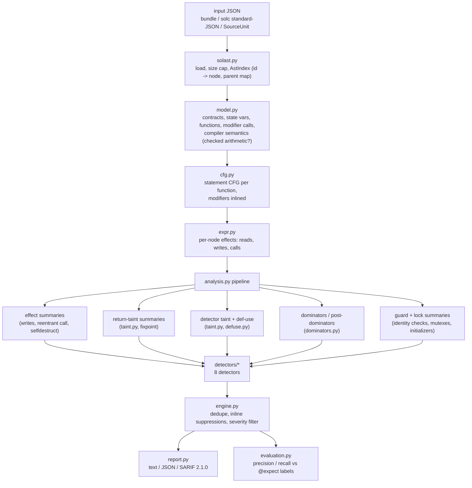

# Architecture

solsentry turns a solc compact JSON AST into findings in six stages. Every stage is a plain
Python module with a typed API; nothing executes contract code and nothing needs a compiler
at analysis time.

## Module map

| Module | Responsibility | Lines (approx.) |
|---|---|---|
| `solast.py` | Parse bundle / standard-JSON / SourceUnit inputs; `AstIndex` id and parent maps | 250 |
| `source.py` | `start:length:file` ranges, byte-accurate line/column mapping | 100 |
| `model.py` | `Program`, `ContractInfo`, `FunctionInfo`, `StateVar`, pragma and version logic | 300 |
| `expr.py` | Call classification from `typeIdentifier`, l-value roots, `EffectCollector`, `expr_key` | 450 |
| `cfg.py` | `CfgBuilder` (modifier inlining, loops, try/catch, revert/halt edges), text/DOT output | 460 |
| `dominators.py` | Cooper-Harvey-Kennedy dominator and post-dominator trees | 110 |
| `dataflow.py` | Generic forward worklist solver | 70 |
| `defuse.py` | Reaching definitions and def-use chains | 70 |
| `taint.py` | Label lattice, flow-sensitive taint, `ReturnSummary` | 230 |
| `analysis.py` | `FunctionAnalysis` (lazy facts, guards, locks), `ProgramAnalysis` (summary fixpoints) | 550 |
| `detectors/` | Eight detectors on a shared `Detector` base | 800 |
| `engine.py`, `report.py`, `evaluation.py`, `cli.py`, `compile.py` | Orchestration, output, scoring, CLI, pinned solc | 900 |

## Key algorithms

### CFG construction with modifier inlining

`CfgBuilder` walks statements with a *dangling-edge* representation: each handler receives
the list of `(node, label)` edges that flow into it and returns the edges that flow out.
`break`/`continue` append to per-loop lists that are connected once the loop is built, so
no node is ever patched after creation. Unreachable nodes (code after `return`/`revert`)
are pruned at the end.

Modifiers are expanded recursively: level *k* of a function with modifiers
`m1 ... mn` is the body of `m(k+1)` whose `_` placeholder builds level *k+1* into a fresh
sub-graph and then continues at a `JOIN` node. A `return` at level *k* jumps to the `JOIN`
of level *k-1* — Solidity resumes the enclosing modifier after `_` — and the outermost
`return` goes to `EXIT`. Modifier arguments become a `BIND` node that assigns each modifier
parameter, so taint flows into the modifier body like an ordinary assignment. A modifier
with two placeholders produces two copies of the inner levels (bounded by a 50,000-node
cap).

`require`/`assert` statements get an extra `fail` edge to `REVERT`; `revert(...)`,
`revert Error()` and `throw` only reach `REVERT`; `selfdestruct` reaches `EXIT` by a `halt`
edge. An `if` whose one branch cannot reach `EXIT` is therefore recognisable as a guard.

Cost: O(S · P) nodes and edges for S statements and P = product of placeholder counts
along the modifier chain (P = 1 for every real-world modifier we know of).

### Dominators

Cooper, Harvey & Kennedy's iterative algorithm over reverse post-order: each node's
immediate dominator is the intersection (walk-up in the partial tree) of its processed
predecessors. Two passes suffice for structured code, giving O(N · d) where d is the
dominator-tree depth; the worst case is O(N²). Post-dominators run the same code on the
reversed graph rooted at `EXIT`, so "post-dominates" means "every path to normal
termination passes through".

### Dataflow

`solve_forward` is a worklist solver seeded in reverse post-order. Reaching definitions
use sets of `Def(node, var)` with the textbook `OUT = GEN ∪ (IN − KILL)`; only strong
writes (a whole local variable) kill. Taint uses maps `var → frozenset(label)` joined by
per-variable union; storage writes are always weak. Both lattices are finite, transfer
functions are monotone, so the solver terminates; a hard iteration cap turns a bug into a
`SolsentryError` instead of a hang.

Cost: O(N · D) set work per pass for reaching definitions (D definitions), O(N · V · L)
for taint (V variables, L ≤ 11 labels). `make bench` shows the resulting super-linear
growth on synthetic single functions: ~40 µs per CFG node at 585 nodes, ~196 µs per node at
9,335 nodes. Real functions are far below 1,000 nodes.

### Summaries (inter-procedural)

All three summary kinds are least fixpoints over the internal call graph, iterated to
stability (cap: 25 rounds, a warning if reached):

1. **Effect summary** — storage written/read, may make a reentrancy-capable call, may
   `selfdestruct`: union over callees.
2. **Return summary** — taint the function with `arg:i` labels for its parameters; the
   labels reaching `return` (or named return variables at `EXIT`) give `deps` (argument
   indices) and intrinsic labels (`STATE`, `SENDER`, `TIMESTAMP` ...). At a call site the
   result is `labels ∪ ⋃ argLabels[i] for i in deps`. This is how `_msgSender()`,
   `owner()`, `hasRole(role, msg.sender)` and `_random()` become visible to callers.
3. **Guard summary** — `sender_guarded` (an identity check dominates `EXIT`),
   `guard_vars` (storage read by those checks) and `locks` (lock variables acquired on every
   normal exit). Recomputed together with each function's guard facts because a call to a
   guarded helper (`_checkOwner()`) is itself a guard.

### Identity checks, locks and initializers

All three are recognised *structurally* from the CFG and taint facts rather than by
names: see `FunctionAnalysis.is_identity_check`, `_lock_acquires` and
`_initializer_checks`. A check "covers" a node if it strictly dominates it (`require`,
reverting `if`, guarded call) or if one of its branch successors that is entered only from
the check dominates it (plain `if`).

### Detector anchoring and deduplication

Each detector reports on one AST node (documented per detector in `DETECTORS.md`).
Because modifiers are inlined, the same modifier statement can be reached from several
functions; `engine.py` keeps the first finding per `(detector, file, start, length)`. Inline
suppression comments (`solsentry-disable-line`, `solsentry-disable-next-line`, optionally
followed by detector ids) are applied after deduplication.

## Data model of a finding

`Finding(detector, title, severity, confidence, message, location, contract, function,
snippet, related)` — `location` is byte-accurate (`start`, `length`) and 1-based
line/column. The SARIF fingerprint hashes detector, path, contract, function and the
whitespace-normalised snippet, so it survives line shifts.

## Error handling

Every deliberate failure is a `SolsentryError` subclass (`InputError`, `AstFormatError`,
`CompileError`). A function whose CFG cannot be built (unknown construct that breaks an
invariant, node cap) is skipped with a warning and listed in the report's `skipped`
section and in SARIF `toolExecutionNotifications`; analysis of the rest continues. The CLI
maps errors to exit code 2 and never prints a traceback for them.
